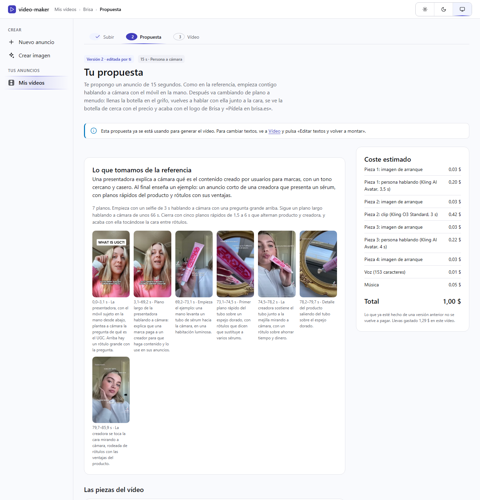
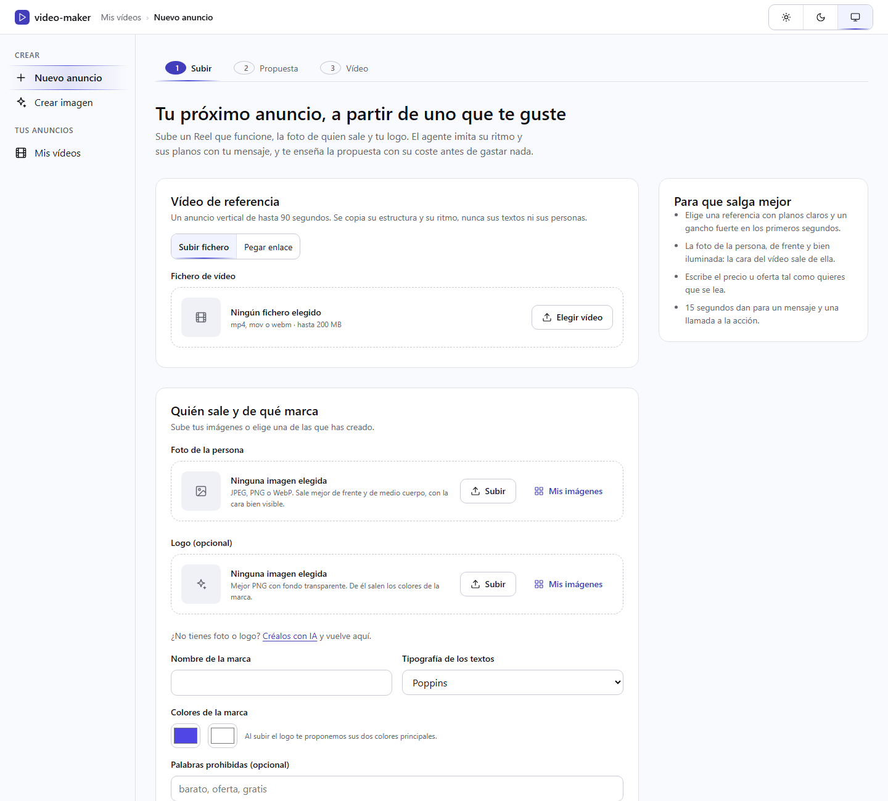
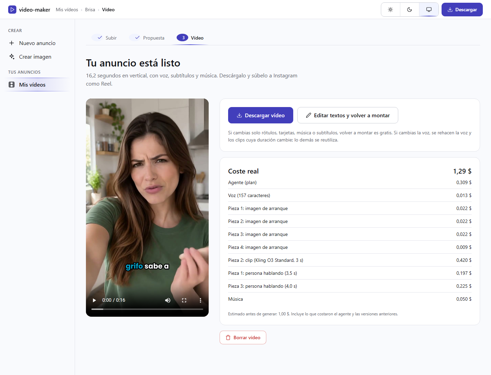
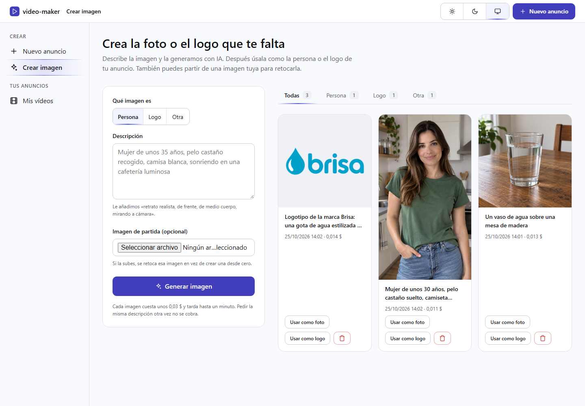
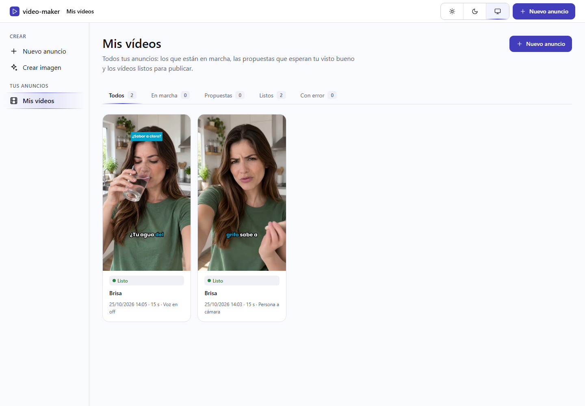

[English](README.md) · **Español**

<div align="center">

# video-maker

**Convierte un Reel que te guste en tu propio anuncio vertical, con tu persona, tu marca y tu mensaje.**


[](#instalación)
[](#cómo-funciona)



</div>

## Para qué sirve

Hacer un anuncio de Instagram que funcione cuesta tiempo: guion, planos, voz, subtítulos, música y
montaje. video-maker parte de un anuncio que ya funciona y que te gusta. Imita su estructura, su
ritmo y sus tipos de plano, y lo rehace con la persona de tu foto, tu logo y tu mensaje. Antes de
gastar nada te enseña la propuesta con su coste, y puedes cambiarla.

El resultado es un MP4 vertical de 720×1280, de 10 a 30 segundos, con voz en castellano,
subtítulos palabra a palabra, rótulos, logo y música.

## Qué hace

| Paso | Qué ocurre |
|---|---|
| **Subir** | Subes o enlazas el vídeo de referencia, la foto de la persona y el logo, y escribes qué anuncias |
| **Propuesta** | Un agente (Claude) mira la referencia plano a plano y escribe el anuncio: piezas, voz, rótulos y música. Ves el coste estimado, editas los textos o le pides un cambio en una frase |
| **Vídeo** | Se genera la voz, las imágenes, los clips y la música, y se monta. Lo descargas listo para subir |

Dos modos:

- **La persona habla a cámara.** La persona de la foto dice el mensaje, con una voz de ElevenLabs
  y la boca generada a partir del audio (Kling AI Avatar).
- **Voz en off.** Un narrador cuenta el mensaje sobre planos generados (Kling O3).

Además, **Crear imagen** genera con IA la foto o el logo que te falte.

| | |
|---|---|
|  |  |
|  |  |

## Instalación

Necesitas Windows, macOS o Linux con:

| Programa | Versión | Para qué |
|---|---|---|
| PHP | 8.2 o superior, con `gd`, `intl`, `mbstring`, `curl` | La aplicación |
| Composer | 2 | Las dependencias |
| Symfony CLI | cualquiera reciente | El servidor local |
| FFmpeg y ffprobe | 6 o superior | Fotogramas, audio y montaje |
| yt-dlp | reciente | Solo si das la referencia como enlace |

En Windows, con winget:

```powershell
winget install Gyan.FFmpeg
winget install yt-dlp.yt-dlp
```

Después:

```bash
git clone https://github.com/Dasge97/video-maker.git
cd video-maker
composer install
```

## Configuración

Las claves van en `.env.local`, que no se versiona:

```dotenv
ANTHROPIC_API_KEY=...        # el agente
OPENAI_API_KEY=...           # imágenes de arranque, fondos y «Crear imagen»
ELEVENLABS_API_KEY=...       # voz y música
FAL_KEY=...                  # clips y persona hablando
AIHUB_URL=https://...        # transcripción de la referencia
AIHUB_API_KEY=...
```

Otras variables, con su valor por defecto en `.env`:

| Variable | Por defecto | Qué cambia |
|---|---|---|
| `ANTHROPIC_MODEL` | `claude-opus-5-5` | El modelo del agente |
| `OPENAI_IMAGE_MODEL` | `gpt-image-2.5-sunburst` | El modelo de imágenes |
| `VIDEO_MODEL` | `balanced` | `balanced` (Kling O3 Standard) o `high` (Kling O3 Pro) |
| `MAX_PAID_CLIPS` | `5` | Límite de piezas que generan un clip de pago en un anuncio |

Los modelos de vídeo y sus precios están en `config/models.yaml`; la voz, la música y la persona
hablando, en `config/sound.yaml`.

## Uso

Arranca el servidor y el proceso de fondo, cada uno en su terminal:

```powershell
$env:PHP_FCGI_MAX_REQUESTS = '0'   # en Windows, sin esto el servidor se cae tras unas 500 peticiones
symfony serve --no-tls --port=8010
```

```bash
php bin/console app:worker
```

Abre http://127.0.0.1:8010 y pulsa **Nuevo anuncio**.

Comandos útiles:

| Comando | Qué hace |
|---|---|
| `php bin/console app:worker` | El proceso de fondo: hace los pasos pendientes de cada vídeo |
| `php bin/console app:demo-montage` | Monta un vídeo de prueba de 12 s sin proveedores, para revisar el montaje |
| `php bin/console app:probe <voice\|image\|avatar\|clip\|music>` | Una llamada de pago de prueba a un proveedor |
| `php bin/phpunit` | Las pruebas, con los proveedores simulados |

## Cómo funciona

```
Navegador ──► Symfony (pantallas Twig)  ──escribe──►  var/jobs/<id>/job.json
                                                            ▲
                                       php bin/console app:worker (lee, hace el paso, guarda)
                                                            │
             ffmpeg · AI Hub · Anthropic · OpenAI · ElevenLabs · fal.ai
```

- **Sin base de datos ni colas.** Cada vídeo es una carpeta con su `job.json`. Un único proceso de
  fondo hace los pasos en orden: comprobar ficheros, fotogramas, transcripción y agente; después
  voz, imágenes, clips, música y montaje.
- **Un solo agente.** Una llamada a Claude con todas las pautas produce el plan completo. Unas
  comprobaciones automáticas (ritmo de la voz, duración, rótulos legibles, cifras inventadas,
  palabras prohibidas…) le devuelven los errores en la misma conversación para que corrija.
- **Primero la voz.** La voz fija cuánto dura cada pieza; cada clip se pide con esa duración.
- **Nunca se paga dos veces.** Cada resultado se guarda por el hash de lo que se pidió. Un clip
  enviado a fal.ai se apunta antes de esperar su resultado y no se reenvía. Si cambias solo
  rótulos o música, volver a montar es gratis.

La documentación completa está en [`docs/`](docs/01-objetivo.md): objetivo, arquitectura, el
agente, los proveedores con sus precios, las pantallas, el plan de trabajo y las lecciones de las
pruebas reales.

## Licencia

Uso privado. Todos los derechos reservados.
