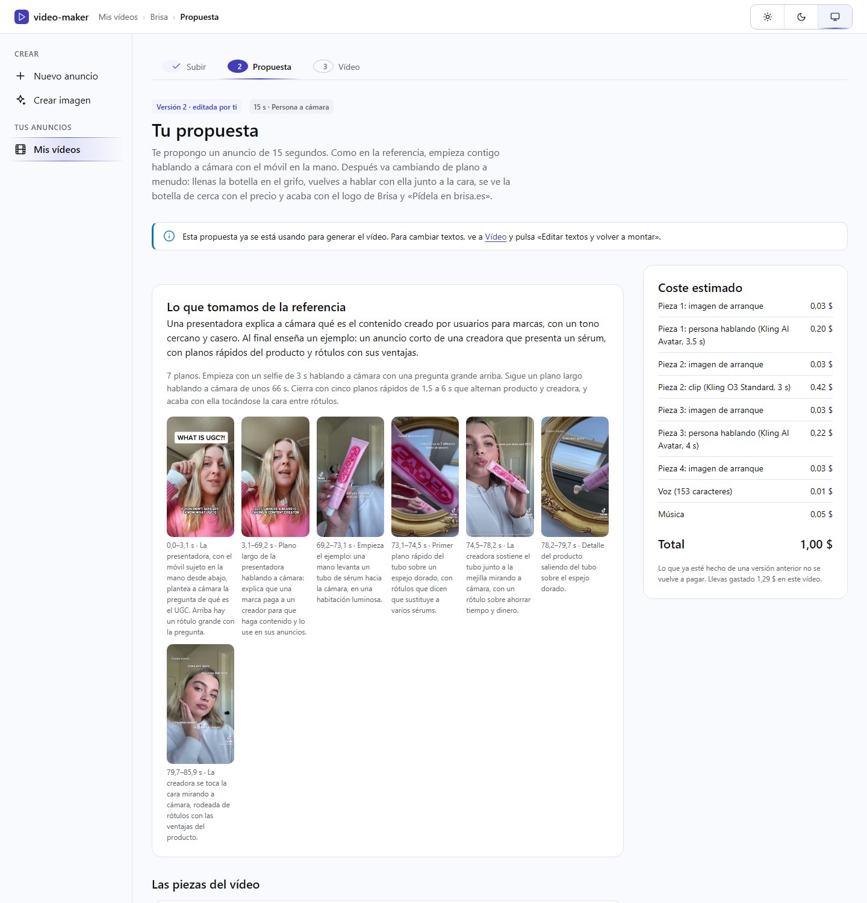
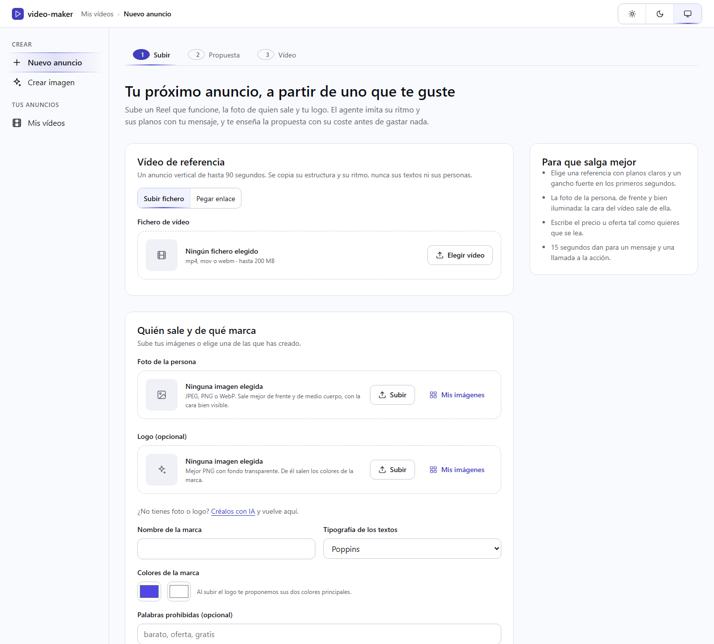
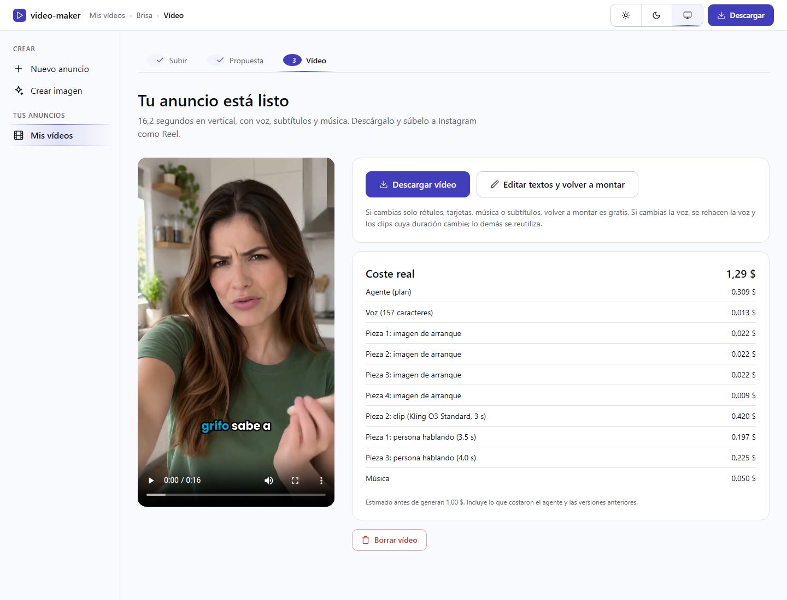
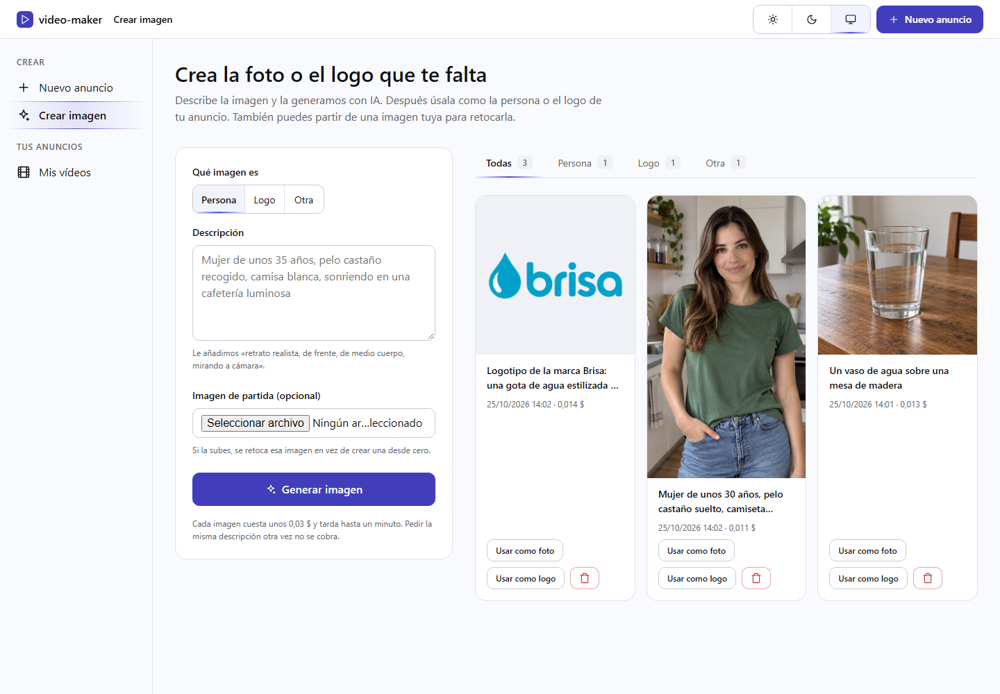
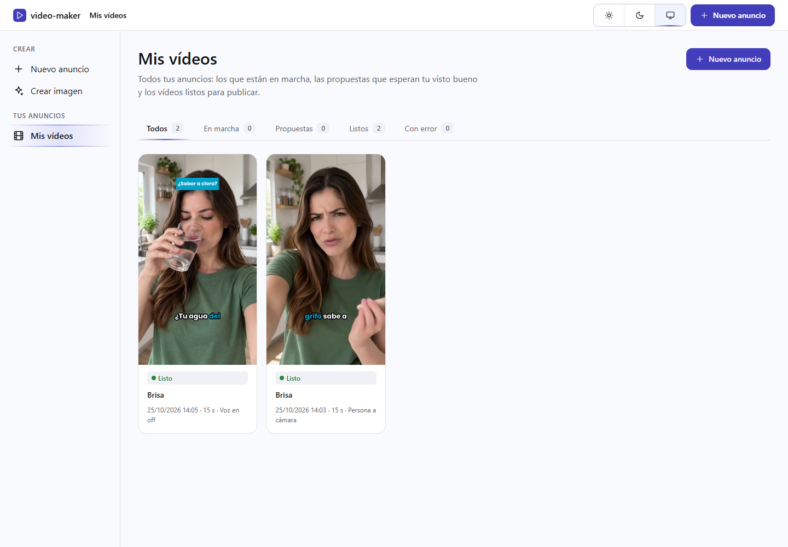

**English** · [Español](README.es.md)

<div align="center">

# video-maker

**Turn a Reel you like into your own vertical ad, with your person, your brand and your message.**


[](#install)
[](#how-it-works)



</div>

## What it is for

Making an Instagram ad that works takes time: script, shots, voice, subtitles, music and editing.
video-maker starts from an ad that already works and that you like. It imitates its structure,
its rhythm and its kinds of shot, and remakes it with the person in your photo, your logo and
your message. Before spending anything it shows you the proposal with its cost, and you can change
it.

The result is a vertical 720×1280 MP4 of 10 to 30 seconds, with a Spanish voice, word-by-word
subtitles, labels, logo and music. The interface is in Spanish.

## What it does

| Step | What happens |
|---|---|
| **Subir** (upload) | You upload or link the reference video, the photo of the person and the logo, and write what you advertise |
| **Propuesta** (proposal) | An agent (Claude) looks at the reference shot by shot and writes the ad: pieces, voice, labels and music. You see the estimated cost, edit the texts or ask for a change in one sentence |
| **Vídeo** (video) | Voice, images, clips and music are generated and edited together. You download it ready to post |

Two modes:

- **The person talks to camera.** The person in the photo says the message, with an ElevenLabs
  voice and a mouth generated from the audio (Kling AI Avatar).
- **Voice-over.** A narrator tells the message over generated shots (Kling O3).

Besides, **Crear imagen** (create image) generates with AI the photo or the logo you are missing,
and **Ajustes** (settings) keeps your keys, your spending limit and your brands (logo, colours
and font) so you do not repeat them.

| | |
|---|---|
|  |  |
|  |  |

## Install

You need Windows, macOS or Linux with:

| Program | Version | For |
|---|---|---|
| PHP | 8.2 or later, with `gd`, `intl`, `mbstring`, `curl` | The application |
| Composer | 2 | Dependencies |
| Symfony CLI | any recent one | The local server |
| FFmpeg and ffprobe | 6 or later | Frames, audio and editing |
| yt-dlp | recent | Only when the reference is given as a link |

On Windows, with winget:

```powershell
winget install Gyan.FFmpeg
winget install yt-dlp.yt-dlp
```

Then:

```bash
git clone https://github.com/Dasge97/video-maker.git
cd video-maker
composer install
```

## Configuration

Each person logs in with their account and enters **their own keys** in **Ajustes** (settings):
everyone pays for their own videos, directly to each provider. Without the four keys no video
can be made.

| Key | What for |
|---|---|
| Anthropic | The agent that writes the proposal |
| ElevenLabs | The voice, the music and the transcription of the reference |
| fal.ai | The video clips and the talking person |
| OpenAI | The start images and «Crear imagen» |
| AI Hub (optional) | Transcribing the reference with your own AI Hub instead of ElevenLabs |

The keys are stored encrypted with a server secret kept in `.env.local`, which is not versioned.
Create it once:

```bash
php -r "echo 'APP_SECRET='.bin2hex(random_bytes(16)).PHP_EOL.'APP_KEYS_SECRET='.base64_encode(random_bytes(32)).PHP_EOL;" >> .env.local
```

> [!IMPORTANT]
> Keep `APP_KEYS_SECRET` somewhere safe. If it is lost, the saved keys cannot be read and every
> person has to enter them again.

**Ajustes** also shows the spending of the month, an optional monthly limit (once reached,
nothing new starts), the saved brands and the password change.

Other variables, with their default in `.env`:

| Variable | Default | What it changes |
|---|---|---|
| `ANTHROPIC_MODEL` | `claude-opus-5-5` | The model of the agent |
| `OPENAI_IMAGE_MODEL` | `gpt-image-2.5-sunburst` | The image model |
| `VIDEO_MODEL` | `balanced` | `balanced` (Kling O3 Standard) or `high` (Kling O3 Pro) |
| `REGISTRO_ABIERTO` | `0` | With `1`, anybody can create an account at `/registro`. With `0`, only from the console |
| `MAX_PAID_CLIPS` | `5` | Limit of pieces that make a paid clip in one ad |

Video models and their prices are in `config/models.yaml`; voice, music and the talking person in
`config/sound.yaml`.

## Usage

Start the server and the background worker, each in its own terminal:

```powershell
$env:PHP_FCGI_MAX_REQUESTS = '0'   # on Windows the server dies after about 500 requests without it
symfony serve --no-tls --port=8010
```

```bash
php bin/console app:worker
```

Create your account (the password is asked without showing it):

```bash
php bin/console app:cuenta:crear you@example.com --nombre="Your name"
```

Open http://127.0.0.1:8010, log in, enter your keys in **Ajustes** and click **Crear anuncio**
(create ad).

Useful commands:

| Command | What it does |
|---|---|
| `php bin/console app:worker` | The background worker: does the pending steps of every video |
| `php bin/console app:demo-montage` | Edits a 12 s test video without providers, to check the editing |
| `php bin/console app:cuenta:crear <email>` | Creates an account. `--adoptar` gives it the videos and images made before accounts |
| `php bin/console app:probe <voice\|image\|avatar\|clip\|music> <email>` | One paid test call to a provider, with the keys of that account |
| `php bin/phpunit` | The tests, with the providers imitated |

## How it works

```
Browser ──► Symfony (Twig screens)  ──writes──►  var/jobs/<id>/job.json
                                                       ▲
                                  php bin/console app:worker (reads, does the step, saves)
                                                       │
         ffmpeg · AI Hub · Anthropic · OpenAI · ElevenLabs · fal.ai
```

- **No database, no queues.** Each video is a folder with its `job.json`. A single background
  process does the steps in order: check files, frames, transcription and agent; then voice,
  images, clips, music and editing.
- **One agent.** One call to Claude with every guideline produces the whole plan. Automatic checks
  (voice pace, duration, readable labels, invented figures, forbidden words…) send the errors back
  in the same conversation so it fixes them.
- **Voice first.** The voice fixes how long each piece lasts; each clip is asked with that length.
- **Never paid twice.** Every result is kept by the hash of what was asked. A clip sent to fal.ai is
  written down before waiting for it and never sent again. Changing only labels or music edits the
  video again for free.

The full documentation, in Spanish, is in [`docs/`](docs/01-objetivo.md): goal, architecture, the
agent, the providers with their prices, the screens, the work plan and the lessons from real runs.

## License

Private use. All rights reserved.
